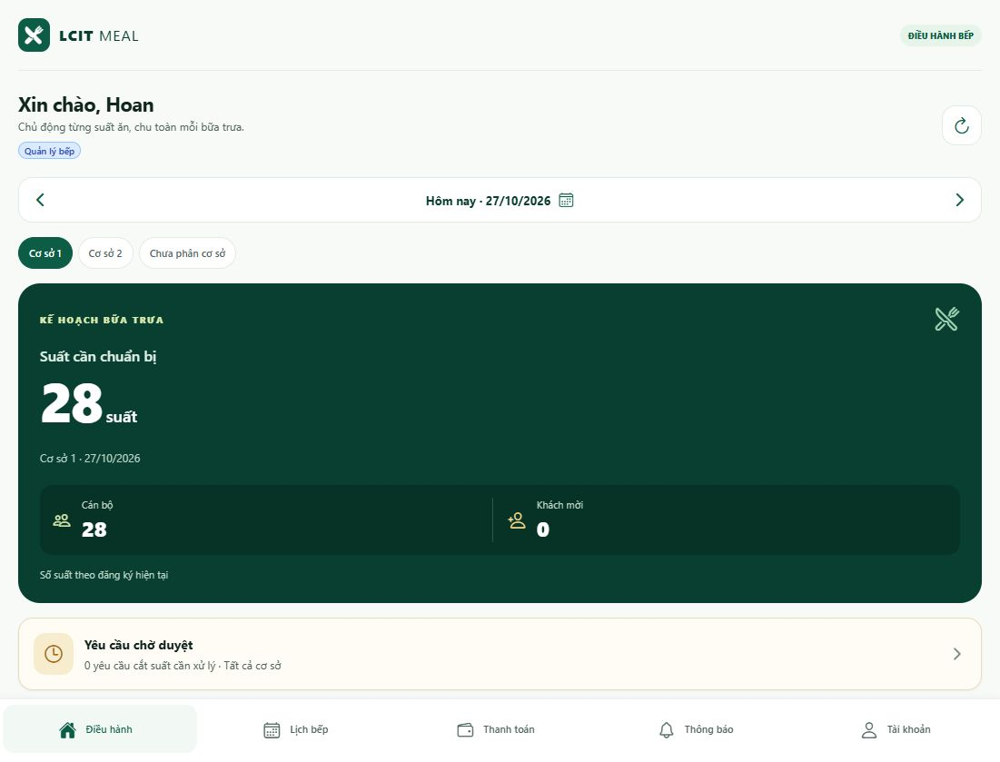

# Hướng dẫn sử dụng LCIT Meal theo từng vai trò

Đối chiếu trực tiếp trên ứng dụng ngày **27/10/2026** tại `http://localhost:5173/`. Các ảnh trong bộ tài liệu được chụp từ phiên kiểm tra này; số suất, khoản thu và số thông báo là dữ liệu tại thời điểm chụp.

## Chọn đúng hướng dẫn

| Bạn đang dùng tài khoản | Vai trò trên ứng dụng | Tài liệu |
| --- | --- | --- |
| `anhnd` | Nhân viên | [Hướng dẫn Nhân viên](docs/HUONG_DAN_NHAN_VIEN.md) |
| `quanlybep` | Quản lý bếp | [Hướng dẫn Bếp](docs/HUONG_DAN_BEP.md) |
| `admin` | Quản trị viên | [Hướng dẫn Admin](docs/HUONG_DAN_ADMIN.md) |

**“Bếp” trong bộ hướng dẫn này là tài khoản `quanlybep`, có quyền Quản lý (Manager).** Nút lọc **Bếp** trong danh sách người dùng lại chỉ vai trò **Nhân viên bếp (Kitchen)**. Hai vai trò này khác nhau; xem cách tìm đúng tài khoản tại [hướng dẫn Admin](docs/HUONG_DAN_ADMIN.md#2-tìm-tài-khoản-và-hiểu-bộ-lọc).

## Đăng nhập và đăng xuất

1. Mở ứng dụng hoặc địa chỉ được cơ quan cung cấp.
2. Nhập **Tên đăng nhập** và **Mật khẩu** được cấp.
3. Bấm **Đăng nhập**.
4. Kiểm tra tên và vai trò trong **Tài khoản**.
5. Để đổi người dùng: **Tài khoản → Đăng xuất → Đăng xuất** trong hộp xác nhận, rồi đăng nhập tài khoản tiếp theo.

Tài liệu dùng tên tài khoản để đối chiếu; mật khẩu do người quản trị cấp riêng.

## Những điểm cần nhớ

- **Nhân viên:** kiểm tra suất hôm nay; nếu không ăn, cắt trước **08:00 sáng giờ Việt Nam**. Khi nút bị mờ và ghi **Quá hạn cắt suất**, ngày đó đã hết hạn thao tác.
- **Bếp:** kiểm tra đúng **ngày** và **cơ sở** trước khi lấy số suất cần nấu.
- **Admin:** kiểm tra bộ lọc cơ sở cùng vai trò khi tìm tài khoản.
- **Chờ duyệt** chưa có nghĩa là đã cắt suất.
- Nút **Đã chuyển** trong cửa sổ QR chỉ đóng cửa sổ; trạng thái thu tiền cần người quản lý đối soát và xác nhận.
- Phân cơ sở hiện được lưu **trên thiết bị/trình duyệt đang dùng**. Nếu đổi thiết bị hoặc xóa dữ liệu trình duyệt, cần kiểm tra lại.
- Số suất cần chuẩn bị và biểu đồ suất đã hoàn thành phục vụ hai mục đích khác nhau; không dùng thay cho nhau.

## Phạm vi đối chiếu

Đã đăng nhập đủ ba tài khoản, mở các màn hình chính và các biểu mẫu liên quan. Đã kiểm tra tên nút, đường đi, bộ lọc, thông báo quá hạn và cách tìm `quanlybep` trong Admin.

Các bước lưu dữ liệu trong hướng dẫn được đối chiếu thêm với phần xử lý hiện có của ứng dụng. Phiên kiểm tra tài liệu dừng trước thao tác gửi cắt suất, tạo tài khoản, xác nhận thu tiền, phát thông báo, đổi cấu hình hoặc chạy tiến trình quản trị; chưa kiểm chứng kết quả lưu của các thao tác này. Tại lúc kiểm tra không có yêu cầu chờ duyệt để thực hiện luồng duyệt thực tế.

Ảnh minh họa:

