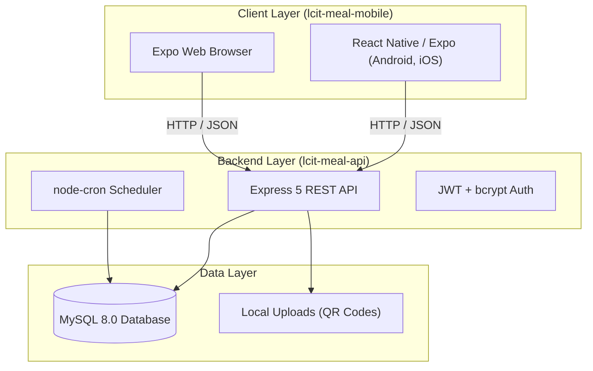

# LCIT Meal — Hệ thống Quản lý Suất ăn Cán bộ Công nhân viên

Hệ thống số hóa toàn diện quy trình phục vụ bữa ăn trưa nội bộ cho cơ quan, doanh nghiệp: tự động đăng ký suất ăn theo lịch làm việc, hỗ trợ cán bộ chủ động báo cắt suất linh hoạt, dự báo chính xác số suất cho bếp ăn, tự động hóa chu kỳ quản lý công nợ và thu tiền ăn hàng tháng qua mã QR.

---

## 📑 Mục lục

1. [Kiến trúc & Công nghệ](#-kiến-trúc--công-nghệ)
2. [Cấu trúc mã nguồn](#-cấu-trúc-mã-nguồn)
3. [Yêu cầu môi trường](#-yêu-cầu-môi-trường)
4. [Hướng dẫn cài đặt & khởi chạy](#-hướng-dẫn-cài-đặt--khởi-chạy)
   - [Bước 1: Khởi động Cơ sở dữ liệu (MySQL)](#bước-1-khởi-động-cơ-sở-dữ-liệu-mysql)
   - [Bước 2: Cài đặt và chạy Backend API](#bước-2-cài-đặt-và-chạy-backend-api)
   - [Bước 3: Cài đặt và chạy Mobile / Web App](#bước-3-cài-đặt-và-chạy-mobile--web-app)
5. [Tài khoản thử nghiệm mặc định](#-tài-khoản-thử-nghiệm-mặc-định)
6. [Các luồng nghiệp vụ cốt lõi](#-các-luồng-nghiệp-vụ-cốt-lõi)
7. [Tài liệu tham khảo liên quan](#-tài-liệu-tham-khảo-liên-quan)

---

## 🏗️ Kiến trúc & Công nghệ

Hệ thống được thiết kế theo mô hình Monorepo gồm 2 thành phần chính:



### Stack công nghệ:
- **Backend API (`lcit-meal-api`)**:
  - Runtime: **Node.js** (>= 20.x)
  - Framework: **Express 5**
  - Database: **MySQL 8.0** (giao thức `mysql2/promise`, SQL viết tay trong Repository layer, không dùng ORM)
  - Xác thực: **JWT (JSON Web Token)**, mật khẩu băm **bcrypt**
  - Tác vụ định kỳ: **node-cron** (tự động tạo suất ăn, chốt hoàn thành bữa trưa)
  - Tiện ích: **Multer** (upload ảnh QR), **ExcelJS / xlsx** (xuất báo cáo đối soát)
- **Frontend Client (`lcit-meal-mobile`)**:
  - Framework: **React Native** & **Expo SDK 51** (hỗ trợ Android, iOS và Web)
  - Điều hướng: **Expo Router v3.5** (File-based navigation)
  - Quản lý trạng thái & Cache: **TanStack React Query v5**
  - Ngôn ngữ: **TypeScript** (Strict mode)
  - Giao diện: Thiết kế Vanilla StyleSheet đồng bộ bảng màu (Color tokens), hỗ trợ chuyển đổi giữa chế độ **Mock Demo** và **API thật**.

---

## 📁 Cấu trúc mã nguồn

```text
appmeal/
├── docker-compose.yml         # Thiết lập container MySQL 8.0 tự động import schema
├── HUONG_DAN_SU_DUNG.md       # Tài liệu hướng dẫn sử dụng chi tiết từng vai trò
├── architecture.md            # Thiết kế kiến trúc tổng thể Backend & Database
├── SPEC.md                    # Đặc tả chi tiết hành vi API, các quy tắc và GAP
│
├── lcit-meal-api/             # Mã nguồn Backend API (Express.js)
│   ├── sql/qlsa.sql           # Schema SQL khởi tạo cơ sở dữ liệu
│   ├── src/                   # Controllers, Services, Repositories, Jobs, Routes
│   ├── .env.example           # Biến môi trường mẫu
│   └── README.md              # Chi tiết hướng dẫn kỹ thuật API
│
└── lcit-meal-mobile/          # Mã nguồn Frontend (React Native Expo)
    ├── app/                   # File-based router (auth, tabs, management, settings...)
    ├── src/                   # Components, API clients, Hooks, Theme, Services
    ├── .env.example           # Biến môi trường kết nối API
    └── README.md              # Chi tiết hướng dẫn kỹ thuật Mobile
```

---

## 💻 Yêu cầu môi trường

- **Node.js**: Phiên bản 20.x trở lên
- **npm**: Phiên bản 10.x trở lên (hoặc yarn / pnpm)
- **Docker & Docker Compose**: Để chạy nhanh MySQL 8.0 (hoặc MySQL Server cài sẵn trên máy)
- **Expo Go / Trình duyệt Web / Android Studio / Xcode**: Để xem giao diện ứng dụng.

---

## 🚀 Hướng dẫn cài đặt & khởi chạy

### Bước 1: Khởi động Cơ sở dữ liệu (MySQL)

Sử dụng Docker Compose có sẵn tại thư mục gốc để khởi động cơ sở dữ liệu MySQL đã tự động nạp cấu trúc bảng từ `lcit-meal-api/sql/qlsa.sql`:

```bash
# Tại thư mục gốc d:\project\appmeal:
docker compose up -d mysql
```

*Thông tin kết nối mặc định của container:*
- **Host**: `localhost`
- **Port**: `3306`
- **Database**: `qlsa`
- **User**: `lcit_user` (hoặc `root`)
- **Password**: `lcit_password` (root password: `rootpassword`)

---

### Bước 2: Cài đặt và chạy Backend API

```bash
# 1. Di chuyển vào thư mục API
cd lcit-meal-api

# 2. Cài đặt các gói phụ thuộc
npm install

# 3. Tạo file cấu hình môi trường .env từ mẫu
cp .env.example .env

# 4. Chạy migration cập nhật bảng phụ trợ (nếu có)
npm run migrate

# 5. Khởi chạy máy chủ ở chế độ phát triển (Development)
npm run dev
```

API sẽ khởi động tại `http://localhost:3000`. Toàn bộ endpoint phục vụ dưới tiền tố `/api` (ví dụ: `http://localhost:3000/api/auth/login`).

---

### Bước 3: Cài đặt và chạy Mobile / Web App

Mở một cửa sổ dòng lệnh (Terminal) mới:

```bash
# 1. Di chuyển vào thư mục Mobile
cd lcit-meal-mobile

# 2. Cài đặt các gói phụ thuộc
npm install

# 3. Tạo file cấu hình môi trường .env (chỉ định URL Backend API)
cp .env.example .env

# 4. Khởi chạy ứng dụng
npm run web           # Mở trực tiếp trên Trình duyệt Web để kiểm thử nhanh
# hoặc:
npx expo start        # Mở QR code quét bằng ứng dụng Expo Go trên điện thoại
npm run android       # Khởi chạy trên máy ảo Android
npm run ios           # Khởi chạy trên máy ảo iOS (macOS)
```

> **Lưu ý cấu hình kết nối Mobile tới Backend:**
> - Nếu chạy ứng dụng trên **Trình duyệt Web**: API URL để `http://localhost:3000`.
> - Nếu quét QR bằng **Expo Go trên điện thoại thật**: Đổi `EXPO_PUBLIC_API_URL` trong `.env` thành địa chỉ IP nội bộ của máy tính trong mạng Wi-Fi (ví dụ: `http://192.168.1.15:3000`).

---

## 👥 Tài khoản thử nghiệm mặc định

Mật khẩu mặc định cho toàn bộ các tài khoản thử nghiệm là: **`123456`**

| Tên đăng nhập | Vai trò | Quyền hạn chính |
| :--- | :--- | :--- |
| **`admin`** | Quản trị viên *(Admin)* | Toàn quyền cấu hình hệ thống, quản lý tài khoản người dùng, xem Audit Log, quản trị đơn giá & lịch tuần. |
| **`manager`** | Quản lý Bếp *(Manager)* | Xem Dashboard thống kê, duyệt yêu cầu cắt suất ăn muộn, thao tác hộ cán bộ, chốt thu tiền ăn và xuất Excel. |
| **`user1`** *(hoặc `user2`, `user3`)* | Cán bộ Nhân viên *(Employee)* | Đăng ký ăn, cắt suất hôm nay / dài hạn, xem công nợ, quét mã QR thanh toán tiền ăn. |
| **`kitchen`** | Nhân viên Bếp *(Kitchen)* | Giao diện thu gọn hiển thị tổng số suất cần nấu hôm nay và trạng thái hoạt động của bếp ăn. |

---

## 🔄 Các luồng nghiệp vụ cốt lõi

1. **Chu kỳ phục vụ suất ăn hằng ngày**:
   - **Tối hôm trước (20:00)**: Cron job tự động sinh ngày ăn và suất ăn `confirmed` cho các cán bộ đang kích hoạt theo lịch làm việc thứ 2 – thứ 6.
   - **Trước giờ chốt (09:00 sáng)**: Cán bộ có thể chủ động bấm Hủy / Đăng ký lại trực tiếp trên ứng dụng.
   - **Sau giờ chốt (09:00 - 10:00)**: Yêu cầu cắt suất chuyển sang trạng thái chờ duyệt (`pending`), Quản lý duyệt hủy hoặc từ chối.
   - **Trưa (09:30 - 11:30)**: Bếp ăn mở app theo dõi số lượng suất cần chuẩn bị thực tế.
   - **Đầu giờ chiều (12:00)**: Hệ thống tự động chuyển trạng thái các suất ăn `confirmed` thành `completed`.
2. **Chu kỳ thu tiền & công nợ hằng tháng**:
   - Quản lý lập bảng đối soát dựa trên các suất ăn `completed` trong tháng.
   - Hệ thống tự động phát thông báo nhắc nộp tiền kèm mã QR chuyển khoản ngân hàng.
   - Cán bộ quét QR thanh toán; Quản lý gạch nợ sau khi kiểm tra sao kê ngân hàng và xuất báo cáo Excel cho bộ phận Kế toán.

---

## 📚 Tài liệu tham khảo liên quan

- 📘 [Hướng dẫn sử dụng theo vai trò](./HUONG_DAN_SU_DUNG.md): Ba tài liệu riêng cho Nhân viên, Bếp/Quản lý bếp và Admin, kèm ảnh đối chiếu trực tiếp trên ứng dụng.
- 🏛️ [Tài liệu Kiến trúc Hệ thống (architecture.md)](./architecture.md): Sơ đồ luồng xử lý, thiết kế cơ sở dữ liệu, quy chuẩn cấu trúc thư mục.
- 📋 [Tài liệu Đặc tả Kỹ thuật & Nghiệp vụ (SPEC.md)](./SPEC.md): Đặc tả chi tiết từng API endpoint, validation và danh mục GAP.
- 🔌 [Tài liệu Backend API README (lcit-meal-api/README.md)](./lcit-meal-api/README.md): Hướng dẫn phát triển, testing và triển khai dịch vụ Backend.
- 📱 [Tài liệu Mobile App README (lcit-meal-mobile/README.md)](./lcit-meal-mobile/README.md): Hướng dẫn xây dựng và đóng gói ứng dụng di động.
