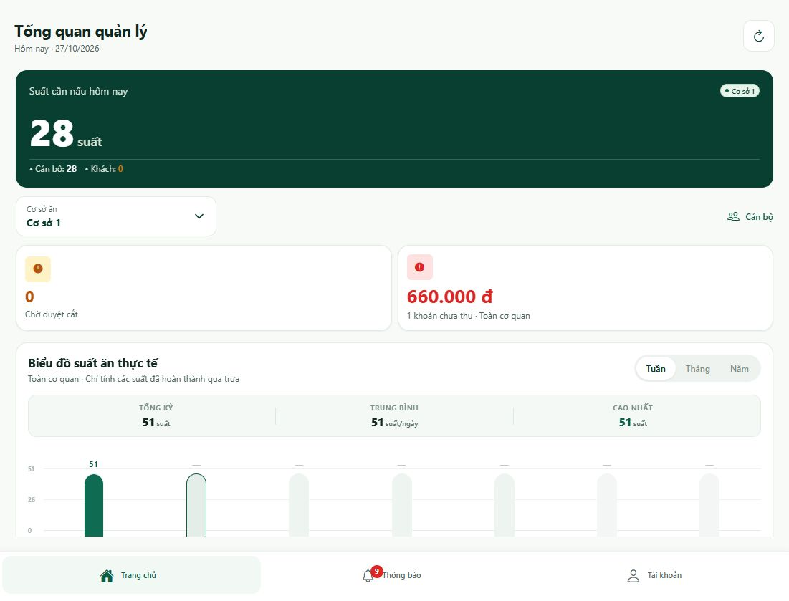
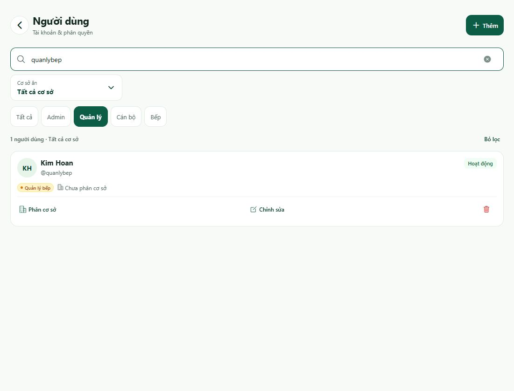
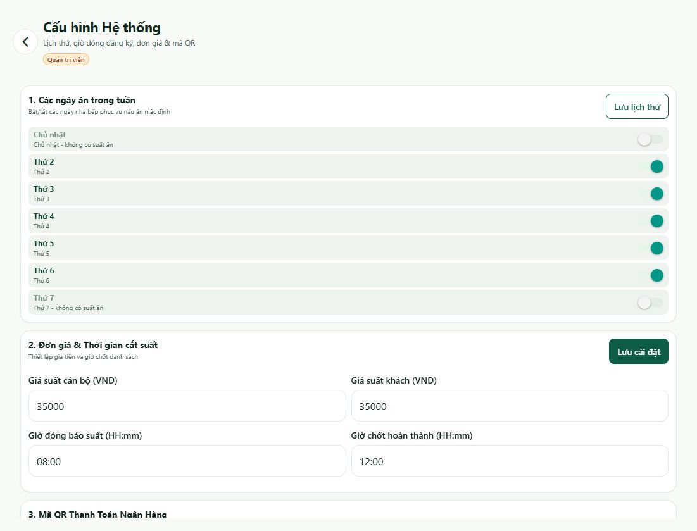

# Hướng dẫn Admin — LCIT Meal

[Chọn vai trò khác](../HUONG_DAN_SU_DUNG.md)

Dành cho tài khoản **`admin`**, vai trò **Quản trị viên**. Đã đăng nhập và mở các phân hệ quản trị ngày **27/10/2026**.

## 1. Nhận biết trang chủ Admin

Sau đăng nhập là **Tổng quan quản lý**. Thanh dưới có **Trang chủ · Thông báo · Tài khoản**; các nghiệp vụ quản lý nằm trong **Không gian quản trị**, kéo xuống để thấy.

| Phân hệ | Dùng để |
| --- | --- |
| Lịch bếp & Nghỉ lễ | Tạo/sửa lịch nấu và sự kiện nghỉ, hủy hoặc mở lại ngày bếp. |
| Đăng ký & Duyệt cắt | Xem đăng ký, duyệt cắt, đăng ký/cắt hộ. |
| Quản lý Thu tiền | Tạo/sửa khoản thu, xác nhận đã nộp, xuất báo cáo. |
| Người dùng & Vai trò | Tìm, tạo, chỉnh sửa tài khoản và phân quyền. |
| Soạn & Phát thông báo | Soạn tin, chọn người nhận và xem lịch sử đã phát. |
| Cấu hình hệ thống | Lịch phục vụ trong tuần, giá tiền, giờ đóng và QR. |
| Nhật ký hệ thống | Tra cứu lịch sử thao tác. |
| Công cụ quản trị | Kích hoạt sinh lịch và chốt suất hoàn thành. |

Thẻ **Suất cần nấu hôm nay** lọc theo cơ sở; công nợ và biểu đồ ghi phạm vi **Toàn cơ quan**. Biểu đồ chỉ tính suất đã hoàn thành, không phải tổng đăng ký dự kiến.

## 2. Tìm tài khoản và hiểu bộ lọc

1. Mở **Trang chủ → Người dùng & Vai trò**, hoặc nút **Cán bộ** gần bộ chọn cơ sở.
2. Kiểm tra cơ sở hiện chọn; mặc định là **Cơ sở 1**.
3. Chọn nhóm **Tất cả / Admin / Quản lý / Cán bộ / Bếp**.
4. Nhập tên, tên đăng nhập, số điện thoại hoặc email.
5. Nếu không thấy người cần tìm, bấm **Bỏ lọc**, rồi nhập lại từ khóa.

**Ví dụ đã kiểm tra trực tiếp — tìm tài khoản bếp:**

1. Bấm **Bỏ lọc** để bỏ điều kiện cơ sở và tìm kiếm trước đó.
2. Chọn **Quản lý**.
3. Tìm `quanlybep`.
4. Kết quả hiển thị **Kim Hoan · @quanlybep · Quản lý bếp · Chưa phân cơ sở** trên thiết bị kiểm tra.

Nút **Bếp** chỉ lọc vai trò **Nhân viên bếp (Kitchen)**. Tài khoản `quanlybep` thuộc **Quản lý (Manager)** nên không hiện khi chọn Bếp.

## 3. Tạo và chỉnh sửa người dùng

### Tạo tài khoản

1. Trong **Người dùng**, bấm **+ Thêm**.
2. Điền **Họ và tên cán bộ**, **Tên đăng nhập**, **Mật khẩu khởi tạo**.
3. Chọn vai trò phù hợp.
4. Nhập số điện thoại/email nếu có.
5. Bấm **Tạo tài khoản**.
6. Kiểm tra kết quả; nếu bộ lọc hiện tại không phù hợp, bấm **Bỏ lọc** rồi tìm tên đăng nhập mới.

| Vai trò trong biểu mẫu | Khi dùng |
| --- | --- |
| Cán bộ (Employee) | Người dùng quản lý suất ăn và tiền ăn cá nhân. |
| Quản lý (Manager) | Người điều hành bếp như `quanlybep`. |
| Admin | Người quản trị tài khoản, cấu hình và công cụ hệ thống. |
| Bếp (Kitchen) | Nhân viên bếp có giao diện lịch bếp/số suất riêng; khác tài khoản quản lý bếp. |

### Sửa thông tin, vai trò hoặc trạng thái

1. Tìm đúng người, bấm **Chỉnh sửa**.
2. Đọc lại tên đăng nhập để tránh sửa nhầm.
3. Cập nhật các trường cần thiết, vai trò hoặc trạng thái.
4. Nếu không đổi mật khẩu, để trống ô mật khẩu mới.
5. Bấm **Lưu thay đổi** và kiểm tra kết quả.

Biểu tượng thùng rác dùng để xóa tài khoản và có hộp xác nhận; chỉ thực hiện khi đã xác định đúng tài khoản cần xóa.

## 4. Phân cơ sở

1. Tìm người dùng.
2. Bấm **Phân cơ sở**.
3. Chọn **Cơ sở 1**, **Cơ sở 2** hoặc **Chưa phân cơ sở**.
4. Kiểm tra nhãn cơ sở trên thẻ người dùng và danh sách suất ăn.

**Phân cơ sở hiện lưu trên thiết bị/trình duyệt này.** Không giả định lựa chọn sẽ tự xuất hiện ở thiết bị khác. Khách đi kèm được tính cùng cơ sở của cán bộ.

Tìm kiếm và vai trò vẫn kết hợp với bộ lọc cơ sở. **Tất cả** trong dãy nút vai trò không đồng nghĩa với bỏ lọc cơ sở; dùng **Bỏ lọc** khi cần xem rộng hơn.

## 5. Lịch bếp, đăng ký, duyệt cắt và thu tiền

Admin có các màn hình nghiệp vụ dùng chung với Quản lý bếp:

- **Lịch bếp & Nghỉ lễ:** xem [mục 5 hướng dẫn Bếp](HUONG_DAN_BEP.md#5-quản-lý-lịch-nấu-và-ngày-nghỉ).
- **Đăng ký & Duyệt cắt:** xem [mục 2–4 hướng dẫn Bếp](HUONG_DAN_BEP.md#2-xem-danh-sách-người-ăn).
- **Quản lý Thu tiền:** xem [mục 6 hướng dẫn Bếp](HUONG_DAN_BEP.md#6-quản-lý-thu-tiền-ăn).

Vào các chức năng này từ **Không gian quản trị** trên Trang chủ. Trước khi xử lý, đọc đúng ngày, cơ sở, người và trạng thái. Duyệt cắt theo đăng ký và duyệt yêu cầu theo khoảng nằm ở hai tab khác nhau.

Với thanh toán, xác nhận **đã nộp** dựa trên tiền thực nhận/chứng từ, không dựa riêng vào việc nhân viên bấm **Đã chuyển** trong cửa sổ QR.

## 6. Soạn và phát thông báo

1. Mở **Soạn & Phát thông báo**.
2. Ở **Soạn thông báo mới**, nhập **Tiêu đề thông báo**, **Nội dung chi tiết**.
3. Chọn phân loại **Hệ thống / Thanh toán / Bếp ăn / Duyệt cắt**.
4. Điền đường dẫn liên kết nếu cần.
5. Chọn **Toàn cơ quan (Broadcast)** hoặc **Chọn từng cán bộ**.
6. Nếu gửi đích danh, chọn đủ người nhận.
7. Bấm **Xem trước & Phát thông báo**.
8. Đọc bản xem trước, kiểm tra người nhận; chọn **Chỉnh sửa lại** hoặc **Xác nhận gửi**.
9. Kiểm tra kết quả trong **Lịch sử đã phát**.

Tab **Thông báo** ở thanh dưới dùng để đọc tin của tài khoản Admin; khác màn hình soạn/phát thông báo.

## 7. Cấu hình hệ thống

Vào **Trang chủ → Cấu hình hệ thống**. Mỗi nhóm có nút lưu riêng.

### Lịch phục vụ trong tuần

1. Bật/tắt các ngày nhà bếp phục vụ mặc định.
2. Bấm **Lưu lịch thứ**.
3. Kiểm tra kết quả trước khi sinh lịch tháng.

### Giá tiền và giờ chốt

1. Điền **Giá suất cán bộ**, **Giá suất khách** bằng VND.
2. Nhập **Giờ đóng báo suất**, **Giờ chốt hoàn thành** theo định dạng `HH:mm`.
3. Bấm **Lưu cài đặt**.

Tại thời điểm kiểm tra, màn hình cấu hình hiển thị 35.000đ cho cả hai loại suất, giờ đóng 08:00 và giờ hoàn thành 12:00. Đây là giá trị đang hiển thị, không phải giá trị cố định cho mọi thời điểm.

**Luồng cắt suất nhân viên hiện chặn sau 08:00 giờ Việt Nam.** Không mặc định việc đổi giờ cấu hình sẽ thay đổi được giới hạn này; cần kiểm tra lại luồng nhân viên khi điều chỉnh quy định.

### Mã QR thanh toán

1. Chọn **Tải ảnh QR từ điện thoại** hoặc nhập **URL hình ảnh mã QR ngân hàng**.
2. Kiểm tra ảnh/thông tin phù hợp.
3. Bấm **Cập nhật mã QR**.
4. Mở khoản thu của nhân viên để kiểm tra thông tin thanh toán hiển thị.

## 8. Nhật ký hệ thống

1. Mở **Nhật ký hệ thống**.
2. Nhập từ khóa tra cứu.
3. Lọc theo **Tất cả / Tạo mới / Chỉnh sửa / Phê duyệt / Thanh toán / Xóa hoặc Hủy**.
4. Mở bản ghi để xem chi tiết khi cần đối chiếu thao tác.

Đối chiếu người thực hiện, thời điểm và nội dung với sự việc cần kiểm tra.

## 9. Công cụ quản trị

Mở **Công cụ quản trị** khi cần chủ động kích hoạt tiến trình.

### Sinh lịch ăn và đăng ký tự động

1. Kiểm tra cấu hình ngày phục vụ và sự kiện nghỉ.
2. Chọn tháng có sẵn hoặc nhập tháng theo dạng `YYYY-MM`.
3. Bấm **Kích hoạt sinh lịch ăn** và đọc xác nhận.
4. Kiểm tra kết quả trong **Lịch bếp & Nghỉ lễ** và **Đăng ký & Duyệt cắt**.

Màn hình mô tả tiến trình tạo lịch tháng và đăng ký mặc định cho cán bộ đang hoạt động, có xét ngày nghỉ và báo cắt.

### Chốt suất hoàn thành

1. Kiểm tra bữa ăn và các điều chỉnh đã xử lý.
2. Nhập ngày theo dạng `YYYY-MM-DD`.
3. Bấm **Chốt trạng thái hoàn thành** và đọc xác nhận.
4. Kiểm tra trạng thái đăng ký và báo cáo sau khi chạy.

Công cụ này chuyển suất **đã xác nhận** sang **đã hoàn thành** phục vụ tính phí/thống kê. Chỉ dùng với đúng ngày cần chốt.

## 10. Khi không thấy dữ liệu

| Hiện tượng | Cách kiểm tra |
| --- | --- |
| Không thấy tài khoản bếp | Bỏ lọc → Quản lý → tìm quanlybep. |
| Chọn vai trò đúng vẫn không thấy người | Bỏ lọc cơ sở; kiểm tra từ khóa. |
| Cơ sở không giống thiết bị khác | Kiểm tra lại phân cơ sở lưu trên thiết bị. |
| Chưa có lịch tháng | Xem lịch thứ, ngày nghỉ; kiểm tra tháng trong công cụ sinh lịch. |
| Biểu đồ không bằng suất cần nấu | Biểu đồ là suất hoàn thành toàn cơ quan; thẻ cần nấu lọc theo cơ sở. |
| Không xuất được danh sách riêng cơ sở | Hiện chưa hỗ trợ Excel theo cơ sở; đọc phạm vi báo cáo trước khi dùng. |

