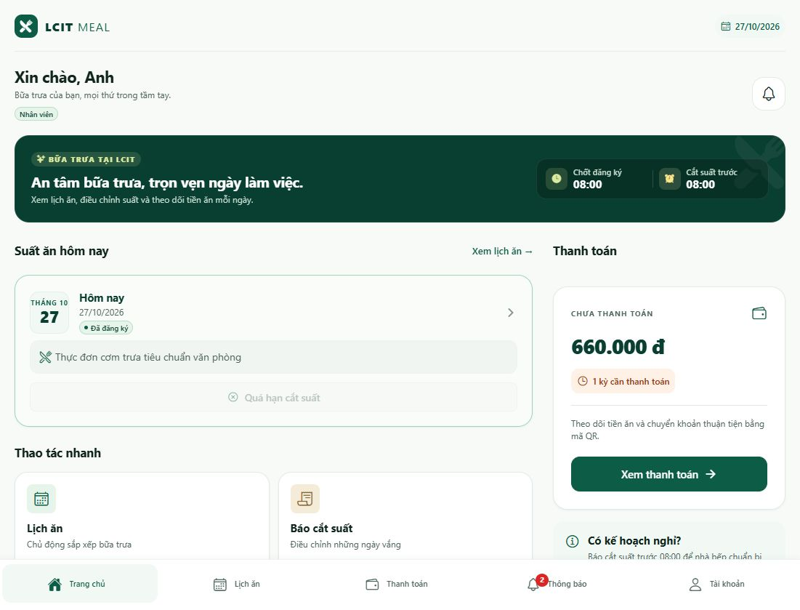
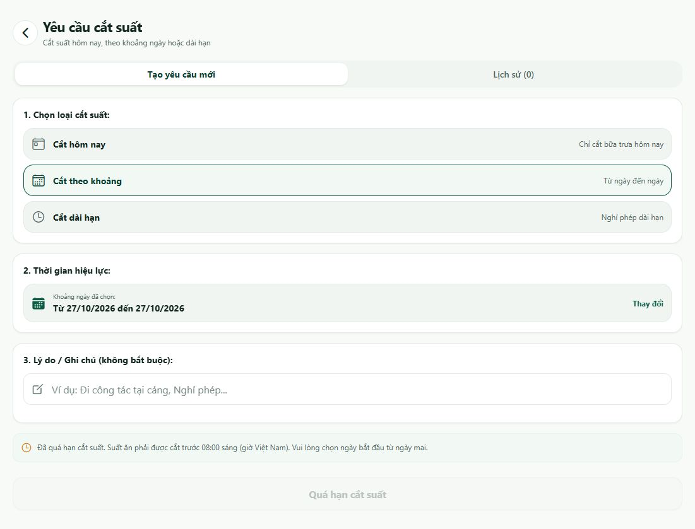

# Hướng dẫn Nhân viên — LCIT Meal

[Chọn vai trò khác](../HUONG_DAN_SU_DUNG.md)

Dành cho tài khoản **`anhnd`**, vai trò **Nhân viên**. Đã đăng nhập và đối chiếu giao diện ngày **27/10/2026**. Số tiền và ngày trong ảnh chỉ là ví dụ tại thời điểm kiểm tra.

## 1. Bắt đầu một ngày

1. Đăng nhập bằng tài khoản được cấp.
2. Mở **Trang chủ**.
3. Kiểm tra **Suất ăn hôm nay**, ngày và trạng thái.
4. Nếu **Đã đăng ký** và vẫn ăn, không cần đăng ký thêm.
5. Nếu không ăn, làm theo mục 3 trước **08:00 sáng của ngày ăn, giờ Việt Nam**.

Trang chủ còn có **Xem lịch ăn →**, **Báo cắt suất**, thông tin khoản tiền chưa thanh toán và nút chuông.

Thanh dưới gồm **Trang chủ · Lịch ăn · Thanh toán · Thông báo · Tài khoản**.

## 2. Xem lịch và chi tiết suất ăn

1. Chọn **Lịch ăn** ở thanh dưới.
2. Chọn **Sắp tới** để xem hôm nay và các ngày tiếp theo; **Lịch sử** để xem ngày đã qua.
3. Lọc **Tất cả**, **Đã đăng ký** hoặc **Đã cắt suất**.
4. Chạm vào thẻ ngày cần xem.
5. Trong **Chi tiết suất ăn**, đọc ngày, thực đơn dự kiến, trạng thái và tiền ăn dự kiến.

Danh sách Lịch ăn hiển thị các ngày; bộ lịch chọn ngày xuất hiện khi mở thao tác cắt nhiều ngày hoặc thay đổi khoảng ngày.

Nếu ngày chưa đăng ký có nút **Đăng ký ăn**, kiểm tra đúng ngày rồi bấm nút; đợi kết quả và kiểm tra lại trạng thái. Không coi việc mở thẻ ngày là đã đăng ký.

## 3. Cắt suất một ngày

1. Vào **Lịch ăn**, mở ngày muốn cắt.
2. Bấm **Cắt suất ăn ngày này**; hoặc bấm **Cắt suất** ngay trên thẻ ngày.
3. Đọc ngày trong hộp **Xác nhận cắt suất ăn**.
4. Bấm **Xác nhận cắt** để gửi; **Giữ lại** để đóng mà không cắt.
5. Đọc kết quả và kiểm tra lại trạng thái.

**Hạn thao tác:** trước 08:00 của ngày ăn. Ví dụ, có thể cắt suất ngày mai từ hôm nay. Nếu hôm nay đã quá hạn, chọn ngày khác không thay thế được việc cắt suất hôm nay.

Khi thấy **Quá hạn cắt suất**, nút bị khóa. Liên hệ quản lý nếu cần xử lý tình huống phát sinh.

| Trạng thái | Cách hiểu |
| --- | --- |
| Đã đăng ký | Đang có suất ăn cho ngày đó. |
| Chờ duyệt | Yêu cầu đang chờ xử lý; chưa coi là đã cắt. |
| Đã cắt suất | Suất đã được ghi nhận cắt. |
| Bếp nghỉ/ngày bị hủy | Kiểm tra thông báo phục vụ của ngày đó. |

## 4. Cắt theo khoảng hoặc dài hạn

1. Mở **Trang chủ → Báo cắt suất**; hoặc **Tài khoản → Yêu cầu cắt suất ăn**.
2. Chọn **Tạo yêu cầu mới**.
3. Chọn loại phù hợp: **Cắt hôm nay**, **Cắt theo khoảng** hoặc **Cắt dài hạn**.
4. Bấm **Thay đổi** ở phần **Thời gian hiệu lực**.
5. Chọn thời gian; kiểm tra lại dòng **Từ … đến …**, rồi áp dụng lựa chọn.
6. Nhập **Lý do / Ghi chú** nếu cần.
7. Khi thông tin hợp lệ, bấm **Xác nhận gửi yêu cầu cắt suất**.
8. Mở **Lịch sử** trong cùng màn hình để xem kết quả.

Ví dụ: nghỉ từ 02/11 đến hết 06/11 thì chọn hai mốc này, ghi lý do “Đi công tác”, rồi gửi.

Nếu ngày bắt đầu đã quá hạn, ứng dụng yêu cầu chọn từ ngày mai. Nếu yêu cầu đang **Chờ duyệt**, đợi quản lý xử lý và kiểm tra lại lịch ăn sau khi được duyệt.

**Lối tắt:** trong **Lịch ăn**, nút **Cắt suất nhiều ngày** mở thao tác chọn khoảng ngày. Kiểm tra khoảng và nội dung xác nhận trước khi gửi.

## 5. Xem và thanh toán tiền ăn

1. Chọn **Thanh toán**.
2. Xem **Tổng tiền cần thanh toán**.
3. Lọc **Tất cả**, **Chưa thanh toán** hoặc **Đã thanh toán**.
4. Đọc kỳ thu, hạn thanh toán và số tiền của khoản cần nộp.
5. Bấm **Quét mã QR**.
6. Kiểm tra ngân hàng, số tài khoản, chủ tài khoản, số tiền và **Nội dung CK**.
7. Dùng ứng dụng ngân hàng để chuyển tiền theo thông tin được cơ quan xác nhận; có thể dùng **Lưu / Chia sẻ mã QR** khi phù hợp.
8. Quay lại theo dõi trạng thái khoản thu sau khi người quản lý đối soát.

**Nút Đã chuyển chỉ đóng cửa sổ QR.** Bấm nút này không tự đổi khoản thu sang đã thanh toán. Nếu đã chuyển nhưng chưa được ghi nhận, gửi thông tin giao dịch cho người phụ trách thu tiền.

## 6. Thông báo, hồ sơ và đăng xuất

- Mở **Thông báo** để đọc tin gửi đến tài khoản. Bấm một tin để xem nội dung; dùng **Đã đọc tất cả** khi muốn đánh dấu các tin.
- Vào **Tài khoản** để kiểm tra đúng họ tên, tên đăng nhập và vai trò.
- Chọn **Chỉnh sửa thông tin & Đổi mật khẩu** khi cần cập nhật hồ sơ. Kiểm tra kết quả lưu trên màn hình.
- Đổi người dùng: **Tài khoản → Đăng xuất → Đăng xuất**.

## 7. Gặp vấn đề thì làm gì?

| Hiện tượng | Cách xử lý |
| --- | --- |
| Không thấy ngày muốn ăn | Kiểm tra Sắp tới/Lịch sử; bỏ bộ lọc trạng thái; hỏi quản lý nếu chưa có lịch. |
| Nút cắt suất bị mờ | Xem thông báo quá hạn; hôm nay sau 08:00 thì liên hệ quản lý. |
| Đã gửi cắt nhưng vẫn hiện suất | Xem Lịch sử yêu cầu và trạng thái chờ duyệt; kiểm tra đúng ngày. |
| Đã chuyển tiền nhưng còn chưa thanh toán | Nhờ quản lý đối soát; nút Đã chuyển không xác nhận thu tiền. |
| Hết phiên hoặc lỗi kết nối | Đăng nhập lại khi được yêu cầu; kiểm tra mạng và thử tải lại. |

**Việc thường làm:** kiểm tra suất hôm nay → báo cắt trước hạn nếu nghỉ → theo dõi yêu cầu → kiểm tra khoản thu.

